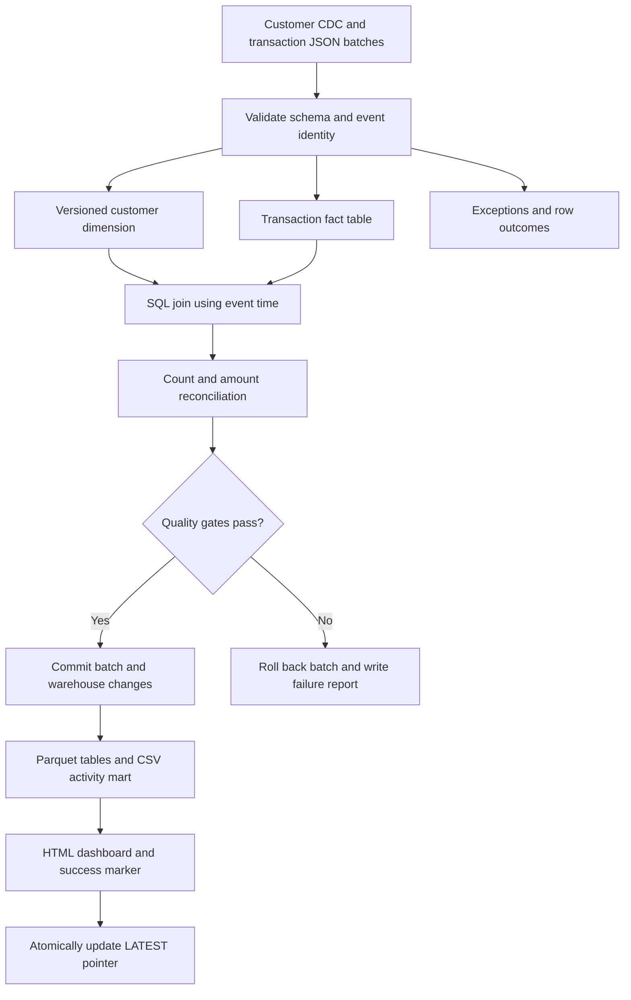

# Customer 360 Data Platform

Turn customer change events and banking transactions into a historical analytics warehouse. This project demonstrates Python ingestion, SQL modeling, slowly changing dimensions (SCD Type 2), source reconciliation, Parquet exports, and safe publication of reporting data.

**Business question:** When a customer moves from retail to business, should last week's transactions change segment? This warehouse classifies each transaction using the customer version effective when it occurred. A late-arriving transaction still joins to the correct historical version.

All records are synthetic. Monetary values are positive transaction volume in USD, represented as integer cents. They are not balances, revenue, or a double-entry ledger.

## Run it end to end

Requires Python 3.12. From the repository root:

```bash
python -m venv .venv
# Windows PowerShell
.venv\Scripts\Activate.ps1
# macOS / Linux
# source .venv/bin/activate
python -m pip install -r requirements.txt
python -m unittest -v
python demo.py
```

The demo prints the absolute path to a generated `dashboard.html`. Open that file in a browser. For a quick preview, open [sample_dashboard.html](sample_dashboard.html) after downloading the repository.

The demo loads two batches, replays the second batch, exports the warehouse, and attempts a third batch with deliberately incorrect source controls. It verifies that the third batch is blocked and `LATEST` continues to point at the successful snapshot. Repeating `python demo.py` with the same output directory safely skips the two already-loaded batches.

## Verified results

| Measure | Result |
| --- | ---: |
| Active customers | 2 |
| Customer history versions, including deletion | 6 |
| Accepted transactions | 6 |
| Total transaction volume | $975.00 |
| Quarantined records | 4 |
| Additional facts after batch replay | 0 |
| Automated tests | 13 |

[sample_results.json](sample_results.json) contains the captured demo output. [sample_activity.csv](sample_activity.csv) contains the exact activity mart exported by the demo.

## Architecture



### Walk through the example

1. Batch `001-bootstrap` creates three customers and accepts three transactions totaling $675.
2. Batch `002-changes` moves customer `c1` to business, changes `c2`'s region, and marks `c3` deleted. It accepts three more transactions totaling $300.
3. Transaction `t7` arrives in the second batch with an event time from before `c1` changed segment. The mart correctly reports it under retail. New transaction `t4` is reported under business.
4. An exact customer replay and an exact transaction replay are skipped. An older customer version is counted as stale.
5. A customer with an invalid version, a conflicting customer event ID, a transaction after customer deletion, and a conflicting transaction ID are quarantined with reasons.
6. Replaying the entire second batch returns `already_loaded`. Reusing its batch ID with different content raises an error.

Deletion is a tombstone in customer history. Historical facts remain attributable to the earlier active version. This models business closure, not privacy erasure.

## Data contract

Each batch contains exactly `batch_id`, `customers`, `transactions`, and `controls`. See the two committed JSON fixtures for complete examples.

| Input | Contract |
| --- | --- |
| Customer event | Unique event ID, customer ID, positive integer version, UTC effective time, segment, region, operation |
| Customer version | Increasing version and increasing effective time per customer |
| Segment and region | `retail` or `business`; `IL`, `NY`, `CA`, or `TX` |
| Operation | `upsert` or `delete`; deletes include the full customer attributes |
| Transaction | Unique transaction ID, customer ID, UTC event time, positive integer amount in cents |
| UTC timestamps | Exact `YYYY-MM-DDTHH:MM:SSZ` format |
| Controls | Number of newly accepted transactions, their total amount in cents, and expected rejected rows |

Source controls must come from an independently calculated source total in a production integration. The fixtures explicitly include duplicates and rejected rows, so their controls describe the expected accepted set. This demo does not infer trustworthy controls from the incoming records.

Customer events within each batch must be ordered by version per customer. Customers are processed before transactions in a batch. A newer customer version with a backdated effective time is rejected. Older customer versions are recorded as stale. Correcting history retroactively requires an explicit backfill design.

## Tables and reporting model

| Relation | Purpose |
| --- | --- |
| `customer_history` | Customer ID and version form the key; validity intervals use inclusive start and exclusive end |
| `customer_events` | Accepted event identity and canonical payload for replay detection |
| `transactions` | One accepted fact per transaction ID; payload enables conflict detection |
| `exceptions` | Batch, source, row number, reason, and rejected payload |
| `outcomes` | Decision for every input row in a committed batch |
| `batches` | Immutable batch ID, SHA-256 content fingerprint, and source controls |
| `current_customers` | Latest version, including deletion status |
| `transaction_detail` | Fact joined to the customer version valid at transaction time |
| `segment_activity` | Daily transaction count and volume by historical segment and region |

[`schema.sql`](schema.sql) defines the warehouse. [`marts.sql`](marts.sql) defines the analytical views. [`warehouse.py`](warehouse.py) implements the actual ingestion and publication path.

## Quality and recovery

Every batch checks that observed new transaction counts, amounts, and rejected-row counts match source controls. SQL checks also enforce one current customer version, non-overlapping history, valid intervals, exactly one dimension match per transaction, and cumulative count and amount reconciliation against the committed batch ledger.

All data changes, exceptions, outcomes, and the batch ledger entry commit in one DuckDB transaction. A failed control or write rolls back the batch so it can be corrected and retried. The CLI writes a failure JSON report and exits with status 1.

Publication validates the warehouse again, writes an immutable snapshot directory with six Parquet exports, CSV output, a dashboard, and `_SUCCESS.json`, then atomically replaces the `LATEST` pointer. Consumers read `LATEST` and only consume the referenced snapshot. Interrupted exports can be regenerated before a success marker is written. Run one writer/publisher at a time, and keep generated snapshot folders immutable.

## Run individual batches

```bash
python warehouse.py run --batch batch_001.json
python warehouse.py run --batch batch_002.json
python warehouse.py publish
```

`load` performs ingestion without publication. `run` loads and publishes. `publish` produces reporting artifacts from committed data. Optional `--db` and `--output` parameters select local destinations.

To inspect a Parquet export:

```python
from pathlib import Path
import duckdb

published = Path('demo-output/published')
snapshot = published / (published / 'LATEST').read_text().strip()
with duckdb.connect() as db:
    print(db.execute(
        'SELECT * FROM read_parquet(?) ORDER BY activity_date, segment, region',
        [str(snapshot / 'segment_activity.parquet')],
    ).fetchall())
```

The CSV can be imported into Power BI or Excel. Amounts are cents, so divide by 100 when displaying currency.

## Docker

```bash
docker build -t customer-360 .
docker run --rm -v customer360-results:/app/demo-output customer-360
```

The named volume retains the generated results between container runs. The Dockerfile is included for portability; local validation was performed with Python. The GitHub workflow runs the tests and demo on Linux and uploads the generated artifacts.

## Scope and next production steps

The runnable implementation uses Python, DuckDB, local JSON batches, and Parquet. It requires no cloud account or paid service. It demonstrates skills used in Azure/Databricks pipelines through a small reproducible warehouse.

A production deployment could ingest CDC through Kafka or Azure Data Factory, store source batches in ADLS, maintain the customer history in Delta Lake, schedule one writer through Airflow or Databricks Workflows, and expose certified marts to Power BI. Those integrations are design extensions. Authentication, distributed writers, privacy erasure, automatic historical backfills, and production-scale performance are outside this local demo.
